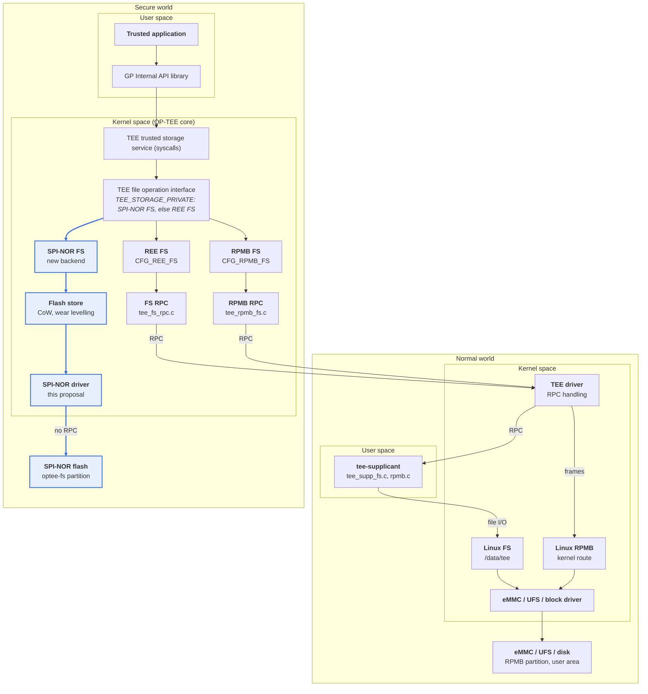
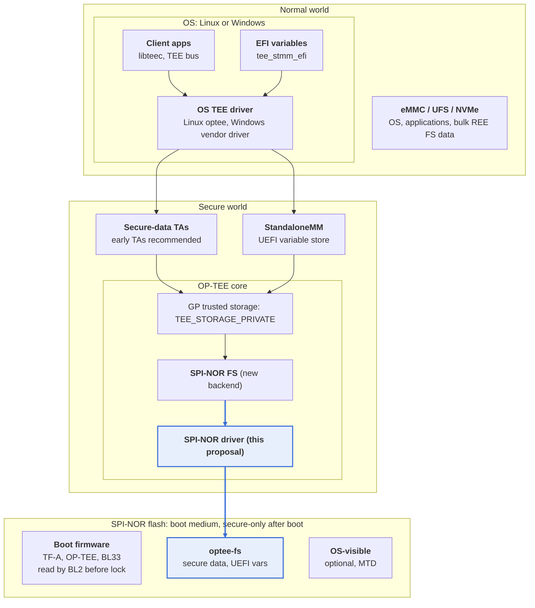
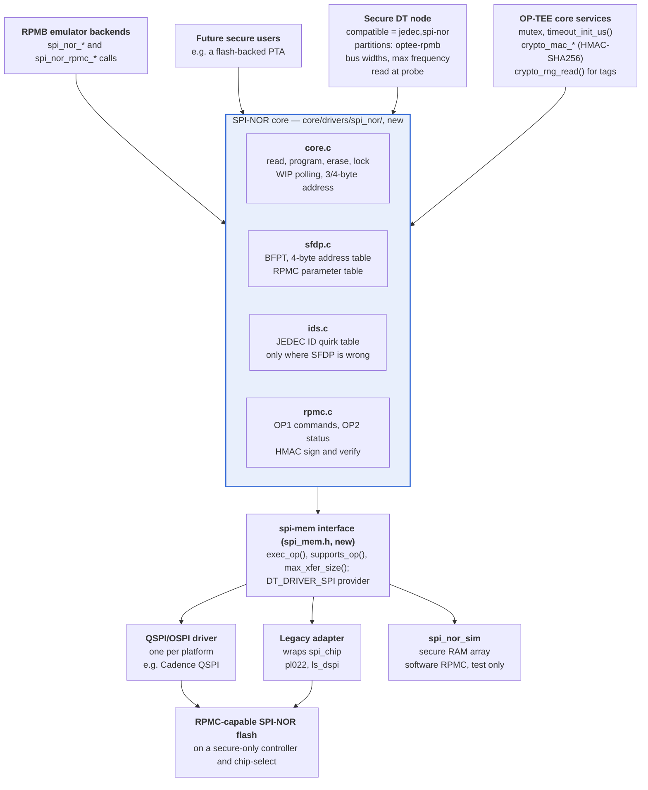
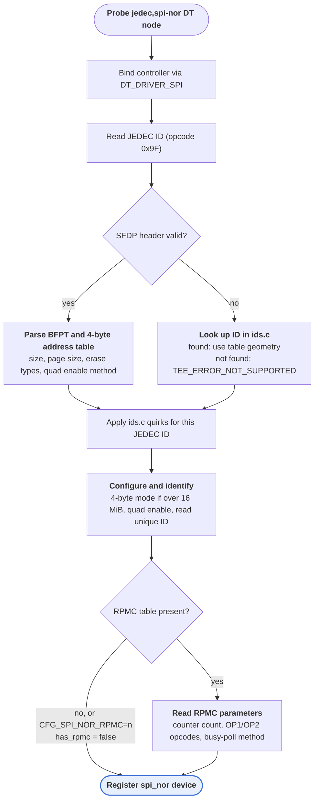
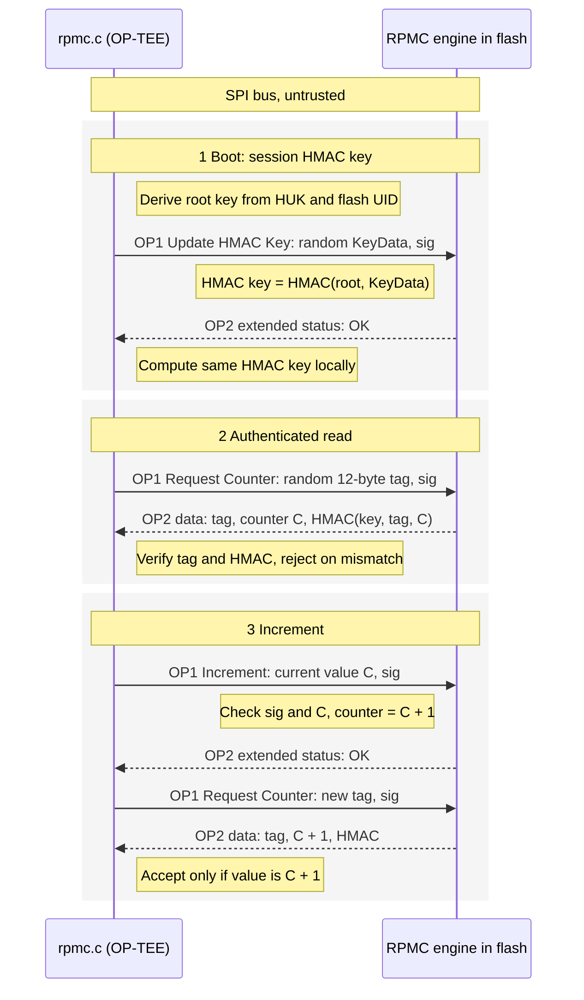
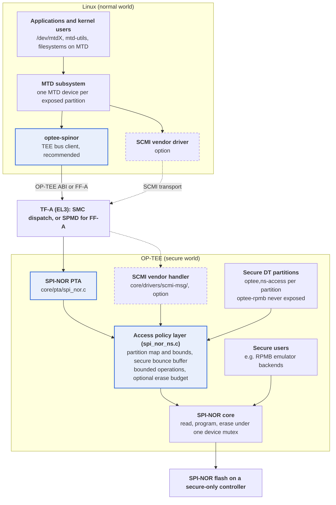
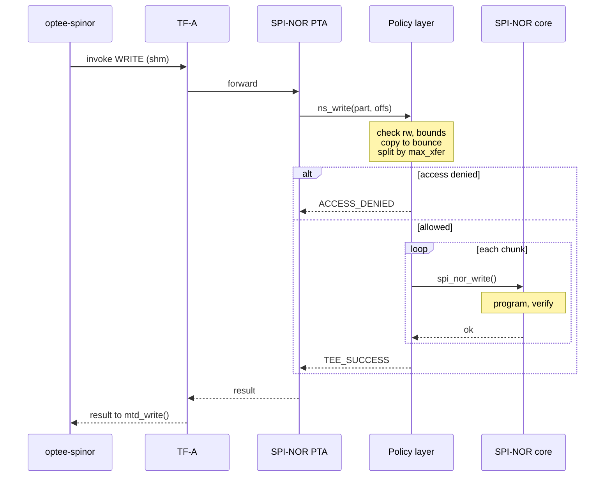

# SPI-NOR Driver for OP-TEE

Oct 27, 2026 · @Bhaskar Valaboju

## Summary

We propose a generic SPI-NOR flash stack for optee\_os: a `spi-mem` controller interface, a SPI-NOR core with JEDEC SFDP discovery, and an RPMC (Replay Protected Monotonic Counter) driver. It gives secure-world code polled access to a secure-only SPI-NOR flash, and exposes RPMC as an authenticated monotonic counter.

The driver stands on its own. Its main consumer is a new secure storage backend, **SPI-NOR FS**. SPI-NOR FS sits beside REE FS and RPMB FS and keeps TA objects in the flash with no normal-world hop. When the flash is present, it replaces REE FS as the default for `TEE_STORAGE_PRIVATE`. It does not use RPMB. RPMB emulation over SPI-NOR and RPMC remains a separate, optional proposal: [RPMB Emulation over Untrusted Storage and a Monotonic Counter](https://claude.ai/artifact/EMcaXgMB6Sh95gYGtv4nLR). Other users could be firmware-update staging or a flash-backed PTA.

**Goals**

- A SPI-NOR core that works over any QSPI/OSPI controller through a small `spi-mem` operation interface, plus an adapter for the existing `spi_chip` drivers.
- SFDP discovery (geometry, erase types, 4-byte addressing, quad enable, RPMC parameter table) with a small ID table for quirks.
- An RPMC driver: root key provisioning, HMAC key update, authenticated counter read and increment.
- A SPI-NOR FS secure storage backend beside REE FS, used for `TEE_STORAGE_PRIVATE` when the flash is present, with no dependency on RPMB.
- Exclusive, secure-only ownership of the flash and its controller.
- Testable on `qemu_v8` in CI with a simulated flash.

**Non-goals**

- A full MTD/UBI stack, or exposing the flash to TAs as a raw block device.
- A Linux MTD driver driving the same controller directly. Linux reaches the flash through OP-TEE instead (see Non-secure access service).
- XIP or memory-mapped boot flash support.
- RPMB emulation itself. This doc only covers the small glue that registers SPI-NOR and RPMC as backends.

## Background

Today OP-TEE's SPI support is a byte-pump interface with no flash layer. Both facts were checked against the optee\_os checkout at commit `73b2d2075`.

**SPI support today**

- `core/include/spi.h` defines `struct spi_ops` with `configure/start/txrx8/txrx16/end`: full-duplex single-lane transfers only. No command/address/dummy phases, no dual/quad lanes.
- Two controller drivers implement it: `pl022_spi.c` and `ls_dspi.c`. There is no SPI-NOR, SFDP or MTD layer. `core/drivers/nvmem/atmel_sfc.c` is an OTP fuse controller, not a flash driver.

**SPI-NOR and RPMC**

- SPI-NOR programs in 256-byte pages, erases in 4 KiB sectors (also 32/64 KiB blocks), and endures roughly 100k erase cycles per sector. A program can only clear bits; an erase sets them to 1.
- RPMC (Replay Protected Monotonic Counter) is an optional SPI-NOR feature described by an SFDP parameter table. Parts that ship it include Winbond W25R/W77 and Macronix ArmorFlash families. The chip offers a few (typically 4) 32-bit counters that can only go up.
- Each counter has a 256-bit root key written once. A per-session HMAC key is derived inside the flash as HMAC-SHA256(root key, KeyData). Increment and read commands are signed with that HMAC key, and read responses return HMAC(HMAC key, tag ‖ counter), so the SPI bus does not need to be trusted.
- RPMC protects a counter only. It does not authenticate or protect the flash array. Pairing it with integrity-protected storage is the job of the RPMB emulation proposal.

The exact RPMC opcodes (commonly `0x9B` for commands and `0x96` for status/data), status bits and counter endurance vary by vendor and must come from the SFDP table and the datasheet. Numbers here are approximate and are not taken from a specific datasheet.

## Secure storage on SPI-NOR

OP-TEE's [secure storage](https://optee.readthedocs.io/en/latest/architecture/secure_storage.html) has two backends, and both keep the physical media in the normal world. The OP-TEE documentation says it directly: "There is no eMMC controller driver in OP-TEE. The device operations all have to go through the normal world." Every storage access therefore leaves the secure world as an RPC, is served by Linux, and then resumes OP-TEE.

With this driver, OP-TEE gets a third backend, **SPI-NOR FS**, that stores TA objects directly in a secure-only flash partition. It sits beside REE FS, does not use RPMB, and replaces REE FS as the default for `TEE_STORAGE_PRIVATE` when the flash is present.

| Backend | Path to the media | Normal-world work per request |
| --- | --- | --- |
| REE FS (`CFG_REE_FS`) | REE FS → `tee_fs_rpc.c` → `OPTEE_RPC_CMD_FS` → Linux TEE driver → tee-supplicant (`tee_supp_fs.c`) → Linux file system → block driver | A world switch out through EL3 and back, a wake-up of the user-space supplicant, and file system calls. One GP write usually needs several of these RPCs, for the object file, its hash-tree nodes and `dirf.db`. |
| RPMB FS (`CFG_RPMB_FS`) | RPMB FS → `tee_rpmb_invoke()` → `OPTEE_RPC_CMD_RPMB_FRAMES` → Linux TEE driver → in-kernel RPMB subsystem (`rpmb_route_frames()`), or tee-supplicant (`rpmb.c`) through the MMC `ioctl()` → eMMC/UFS driver | A world switch out and back, and the Linux MMC/UFS stack. The supplicant route adds a user-space round trip. |
| SPI-NOR FS (`CFG_SPI_NOR_FS`, new) | SPI-NOR FS → `fs_htree.c` and `fs_dirfile.c` (shared with REE FS) → flash store → SPI-NOR core → spi-mem → controller | None. Each request becomes local SPI transactions. |



*Figure: Secure storage stack, after the OP-TEE secure storage architecture figure · grey = today's paths, blue = new path*

SPI-NOR FS reuses everything in REE FS above its transport and replaces only the bottom layer. TAs keep using the GP trusted storage API unchanged.

### Design of SPI-NOR FS

| Layer | REE FS today | SPI-NOR FS |
| --- | --- | --- |
| File operations | `ree_fs_ops` in `core/tee/tee_ree_fs.c` | `spinor_fs_ops` in a new `core/tee/tee_spinor_fs.c`, the same `struct tee_file_operations` |
| Per-object encryption and integrity | `fs_htree.c`: per-file key, hash tree, keys derived from the HUK | Same code, unchanged |
| Directory | `fs_dirfile.c` (`dirf.db`) | Same code, unchanged |
| Transport | `tee_fs_rpc.c` → `OPTEE_RPC_CMD_FS` → tee-supplicant → Linux file system | `core/tee/spinor_fs_store.c` → SPI-NOR core API |
| Rollback anchor | `dirf.db` hash in RPMB (`CFG_REE_FS_INTEGRITY_RPMB`), or none | Commit record in the flash, optionally bound to an RPMC counter |

- **Flash store.** `spinor_fs_store.c` gives `fs_htree` numbered files with block read and write, as tee-supplicant does for REE FS. Inside, it is log-structured: each write goes to erased space, a map from (file, block) to flash location is updated, and garbage collection reclaims the erase unit with the fewest live blocks. NOR cannot overwrite in place, so this layer owns copy-on-write, wear levelling and power-loss safety.
- **Atomic commits.** `fs_htree` already writes new block versions out of place (version 0 or 1) and finishes by writing a new header. The store makes each commit atomic with an A/B commit record that carries a sequence number and a MAC. Boot picks the newest valid record, so a power cut leaves either the old or the new state.
- **One refactor.** `struct tee_fs_htree_storage` in `core/include/tee/fs_htree.h` is shaped for RPC: `rpc_read_init`/`rpc_read_final` with a `struct tee_fs_rpc_operation` and a buffer in non-secure shared memory. We add backend-neutral `read_block`/`write_block` callbacks, and REE FS keeps its RPC pair. REE FS and RPMB FS behave exactly as before.

### Backend selection

- A new storage ID, `TEE_STORAGE_PRIVATE_SPI_NOR`, lets a TA choose SPI-NOR FS explicitly. It is an OP-TEE extension next to `TEE_STORAGE_PRIVATE_REE` (`0x80000000`) and `TEE_STORAGE_PRIVATE_RPMB` (`0x80000100`). Its value is to be allocated.
- With `CFG_SPI_NOR_FS_DEFAULT=y`, `TEE_STORAGE_PRIVATE` maps to SPI-NOR FS when the secure DT has an `optee-fs` partition, and to REE FS otherwise. `tee_svc_storage_file_ops()` in `core/include/tee/tee_fs.h` becomes a runtime choice instead of today's compile-time `#if`.
- **No silent fallback.** The choice follows the secure DT, which is part of the signed OP-TEE image, not the probe result. If the DT names the partition but the flash fails to probe or verify, storage returns `TEE_ERROR_STORAGE_NOT_AVAILABLE` instead of redirecting to REE FS. Otherwise a flash fault would make existing objects vanish and send new secrets to OS-hosted storage.
- REE FS and RPMB FS stay available under their own storage IDs, for example for objects too large for the flash.

### Rollback protection

- The controller is secure-only, so the OS cannot read, modify or replay the flash. That covers every software attack from the normal world.
- An attacker with physical access could reflash an old image. If the part has RPMC, the store binds each commit's sequence number to an RPMC counter, incrementing it after the commit record is written, and refuses to mount older state. This uses the SPI-NOR's own RPMC directly, not RPMB.
- Without RPMC, SPI-NOR FS has no protection against physical replay, the same as REE FS without RPMB. Platforms that need it must use an RPMC-capable part.

### Configuration

| Option | Default | Meaning |
| --- | --- | --- |
| `CFG_SPI_NOR_FS` | n | SPI-NOR FS backend. Depends on `CFG_DRIVER_SPI_NOR`. |
| `CFG_SPI_NOR_FS_DEFAULT` | n | Map `TEE_STORAGE_PRIVATE` to SPI-NOR FS when the secure DT has an `optee-fs` partition. |
| `CFG_SPI_NOR_FS_RPMC` | n | Bind commits to an RPMC counter. Depends on `CFG_SPI_NOR_RPMC`. |
| `CFG_SPI_NOR_FS_SPARE_PCT` | 25 | Spare space for garbage collection, as a percentage of the partition. |

**What this gives**

- **No dependency on Linux for storage.** Storage works before the Linux TEE driver and tee-supplicant are running, which helps TAs that need storage early in boot, such as an fTPM. A crashed, hung or hostile normal world cannot withhold or delay storage requests, because the flash is not on its bus.
- **Fewer transitions per request.** A request no longer costs world switches, a supplicant wake-up and Linux file handling.
- **Less exposed to the normal world.** Linux no longer sees storage traffic, so it cannot observe access patterns, or drop, delay or reorder storage RPCs.
- **Independent of RPMB.** No eMMC, RPMB key provisioning or RPMB emulator is needed.

**Trade-offs**

- **Capacity:** SPI-NOR parts are typically tens of MiB, and OP-TEE gets one partition of the part.
- **Speed:** a page program takes milliseconds and a sector erase tens of milliseconds or more. Small updates are fast without RPC overhead, but bulk writes are slower than on eMMC.
- **Endurance:** about 100k erase cycles per sector, spread by the store's wear levelling. With RPMC, each commit also uses one counter increment.

So SPI-NOR FS can hold all of a platform's TA data when it fits: keys, certificates, fTPM state, UEFI variables and counters. A TA that needs bulk storage can still choose `TEE_STORAGE_PRIVATE_REE` explicitly.

## Deployment on SPI-NOR boot platforms

Many products already boot from SPI-NOR: TF-A, OP-TEE and the UEFI or U-Boot firmware live in it, while the OS (Linux or Windows) lives on eMMC, UFS or NVMe. On those products the flash is already on the board. This driver lets OP-TEE own it after boot and keep secure data in it. The OS never addresses the flash directly. When it needs to store or read secure data, it calls a TA, and the TA uses GP trusted storage, which lands in SPI-NOR.

### Flash layout and ownership

| Partition | Contents | During boot | After boot | OS access |
| --- | --- | --- | --- | --- |
| Boot firmware | TF-A, OP-TEE, BL33 (UEFI or U-Boot) images | Read by BL2 before OP-TEE runs | OP-TEE | None, or read-only through the non-secure access service. Updates go through a signed update path in the secure world. |
| `optee-fs` | SPI-NOR FS: TA objects and UEFI variables | Not used | OP-TEE | Only through a TA or StandaloneMM |
| OS-visible (optional) | Non-secret data, e.g. logs or a boot environment | Not used | OP-TEE | Read-write MTD through the non-secure access service |

The controller becomes secure-only once the secure firmware has loaded its images and before BL33 starts, for example by BL2 or BL31 programming the TZC or bus firewall. Nothing in the normal world, including UEFI runtime services, may then execute from or program the flash directly. This matches the existing non-goal of no XIP from the boot flash.

### How the OS reaches secure data

- **Through a TA (general case).** A client application (libteec) or a kernel driver (TEE bus) opens a session with a TA. The TA stores objects with `TEE_STORAGE_PRIVATE`, which maps to SPI-NOR FS. GP storage keeps each TA's objects separate by UUID, so the TA decides what the OS may store or read, and what never leaves the secure world: a key can be used inside the TA without ever being returned.
- **UEFI variables through StandaloneMM.** OP-TEE's StandaloneMM support stores variables in secure storage (`core/arch/arm/kernel/stmm_sp.c`), but it names `TEE_STORAGE_PRIVATE_RPMB` explicitly. Pointing it at SPI-NOR FS needs a small change, for example a config option for the storage ID it uses. U-Boot reaches StandaloneMM with `CONFIG_EFI_MM_COMM_TEE`, and Linux replaces the EFI variable services with `tee_stmm_efi`. Today, with eMMC RPMB, U-Boot must also serve OP-TEE's RPMB RPCs itself (`drivers/tee/optee/rpmb.c`) and needs a working eMMC. With SPI-NOR FS it needs neither.
- **Raw partitions (non-secret).** Partitions that the OS may see as plain flash, such as firmware banks or logs, use the non-secure access service and its per-partition policy.



*Figure: Deployment on a SPI-NOR boot platform · blue = secure-data path*

### Linux and Windows

- **Linux** has everything needed: libteec and tee-supplicant for user-space clients, the TEE bus for kernel clients, and `tee_stmm_efi` for UEFI variables.
- **TA loading** is the one normal-world hop left. TAs are normally loaded from the OS file system by tee-supplicant. Early TAs (`CFG_EARLY_TA`, `CFG_IN_TREE_EARLY_TAS`) are linked into the OP-TEE image, which itself lives in SPI-NOR, so the whole secure-data path then works without the OS file system. We recommend early TAs for the secure-data TAs.
- **Windows** has no in-box OP-TEE client driver. The TA route needs a vendor TEE driver for Windows. UEFI variables do not depend on the OS if the firmware's runtime services reach StandaloneMM themselves, for example over FF-A. Both points depend on the platform's firmware and driver stack and are listed as open questions.

This turns the boot flash into the platform's secure data store. Keys, certificates, fTPM state, UEFI variables and anti-rollback counters stay in the secure world. The OS only sees the results it is allowed to get from a TA.

## Design

The driver adds three layers under `core/drivers/`: a `spi-mem` operation interface that controllers implement, a SPI-NOR core that speaks JEDEC commands over it, and an RPMC module on top of the core. All are polled and single-threaded behind a mutex; none needs interrupts.



*Figure: Driver block diagram · new SPI-NOR core highlighted*

Users call only the SPI-NOR and RPMC APIs. Controllers plug in below through spi-mem, so the simulator and real QSPI hardware are interchangeable.

### Layers and tree placement

| Layer | Files | Responsibility |
| --- | --- | --- |
| spi-mem interface | `core/include/drivers/spi_mem.h`, `core/drivers/spi/spi_mem.c` | One `exec_op()` call per command: opcode, address, dummy cycles, data in/out, bus width per phase. DT provider registration. |
| Legacy adapter | `core/drivers/spi/spi_mem_legacy.c` | Wraps an existing `struct spi_chip` (pl022, ls\_dspi) as a 1-lane spi-mem controller, with GPIO chip-select. |
| Controller drivers | `core/drivers/spi/<vendor>_qspi.c` | Platform QSPI/OSPI controllers (e.g. Cadence QSPI, NXP FlexSPI, STM32 OSPI). Added per platform, not in this proposal. |
| SPI-NOR core | `core/drivers/spi_nor/core.c`, `sfdp.c`, `ids.c`, `core/include/drivers/spi_nor.h` | Probe, JEDEC ID, SFDP, read/program/erase, status polling, 3/4-byte addressing, quad enable, block protection. |
| RPMC | `core/drivers/spi_nor/rpmc.c`, `core/include/drivers/spi_nor_rpmc.h` | RPMC command framing, signature generation and verification, extended-status polling. |
| Simulator (test only) | `core/drivers/spi_nor/spi_nor_sim.c` | A spi-mem controller backed by secure RAM that models NOR bit semantics and a software RPMC. |

We keep the existing `core/include/spi.h` untouched so pl022 and ls\_dspi users do not change.

### spi-mem interface

```c
struct spi_mem_op {
	struct { uint8_t nbytes; uint8_t buswidth; uint16_t opcode; } cmd;
	struct { uint8_t nbytes; uint8_t buswidth; uint64_t val; } addr;
	struct { uint8_t nbytes; uint8_t buswidth; } dummy;
	struct {
		uint8_t buswidth;
		enum spi_mem_dir dir;	/* SPI_MEM_NO_DATA, _DATA_IN, _DATA_OUT */
		size_t nbytes;
		union { void *in; const void *out; } buf;
	} data;
};

struct spi_mem_ops {
	TEE_Result (*exec_op)(struct spi_mem *mem, const struct spi_mem_op *op);
	bool (*supports_op)(struct spi_mem *mem, const struct spi_mem_op *op);
	size_t (*max_xfer_size)(struct spi_mem *mem);
};
```

The shape follows Linux and U-Boot `spi-mem`, so controller drivers port with little change. A new `DT_DRIVER_SPI` type in `core/include/kernel/dt_driver.h` lets a flash node find its controller, as `DT_DRIVER_I2C` does for I2C.

### SPI-NOR core API

```c
struct spi_nor_info {
	uint8_t jedec_id[6];
	uint8_t uid[16];		/* factory unique ID (0x4B or 0x5A based) */
	size_t uid_len;
	uint64_t size;
	size_t page_size;		/* program unit, usually 256 */
	size_t erase_size;		/* smallest uniform erase, usually 4096 */
	bool has_rpmc;
};

TEE_Result spi_nor_get_by_dt(const void *fdt, int node, struct spi_nor **nor);
TEE_Result spi_nor_get_info(struct spi_nor *nor, struct spi_nor_info *info);
TEE_Result spi_nor_read(struct spi_nor *nor, uint64_t offs, void *buf, size_t len);
TEE_Result spi_nor_write(struct spi_nor *nor, uint64_t offs, const void *buf, size_t len);
TEE_Result spi_nor_erase(struct spi_nor *nor, uint64_t offs, size_t len);
TEE_Result spi_nor_lock(struct spi_nor *nor, uint64_t offs, size_t len);
```

- `spi_nor_write()` splits at page boundaries, issues WREN + Page Program, polls WIP with `timeout_init_us()`, and reads back to verify. Program/erase failures (vendor error bits in SR/FSR) map to `TEE_ERROR_STORAGE_NOT_AVAILABLE`.
- Erase picks the largest SFDP erase type aligned to the range.
- Probe order: read JEDEC ID, parse SFDP (BFPT + 4-byte address table + RPMC table), then apply quirks from a small `ids.c` table only where SFDP is wrong or missing.
- The flash node uses the standard Linux binding: `compatible = "jedec,spi-nor"` under a controller node in the secure DT, with `spi-max-frequency`, `spi-rx-bus-width`, `spi-tx-bus-width`. A `partitions` subnode names the region OP-TEE owns (e.g. `label = "optee-fs"`).



*Figure: SPI-NOR probe flow · one pass at driver init*

A part without SFDP still works if `ids.c` knows it. RPMC is enabled only when the SFDP table is present and the config allows it.

### RPMC API

```c
struct spi_nor_rpmc_info {
	uint8_t num_counters;
	uint8_t op1, op2;	/* from SFDP, e.g. 0x9B and 0x96 */
	bool busy_poll_by_op2;	/* SFDP: poll extended status vs SR WIP */
	uint32_t update_rate;	/* SFDP hint, encoded per JESD216 */
};

TEE_Result spi_nor_rpmc_get_info(struct spi_nor *nor, struct spi_nor_rpmc_info *info);
TEE_Result spi_nor_rpmc_write_root_key(struct spi_nor *nor, uint8_t ctr, const uint8_t root_key[32]);
TEE_Result spi_nor_rpmc_update_hmac_key(struct spi_nor *nor, uint8_t ctr, const uint8_t root_key[32], uint32_t key_data, uint8_t hmac_key[32]);
TEE_Result spi_nor_rpmc_read(struct spi_nor *nor, uint8_t ctr, const uint8_t hmac_key[32], uint32_t *value);
TEE_Result spi_nor_rpmc_increment(struct spi_nor *nor, uint8_t ctr, const uint8_t hmac_key[32], uint32_t expected_cur);
```

- `spi_nor_rpmc_read()` generates a fresh 12-byte tag with `crypto_rng_read()` and rejects any response whose tag or HMAC does not match. A bad signature is reported as `TEE_ERROR_SECURITY`, never as a counter value.
- `spi_nor_rpmc_increment()` reads back the counter after the command and checks it equals `expected_cur + 1`.
- HMAC-SHA256 comes from the core crypto API (`crypto_mac_*`), so no new crypto backend is needed.
- Key material lives only on the stack and is wiped with `memzero_explicit()` before return.



*Figure: RPMC sequence · solid = command, dashed = response; signature field layout per vendor datasheet*

The root key crosses the bus only once, at factory provisioning. After that, a fresh `KeyData` each boot and a fresh tag each read stop an attacker on the bus from replaying old responses.

### Configuration

| Option | Default | Meaning |
| --- | --- | --- |
| `CFG_DRIVER_SPI_MEM` | n | spi-mem interface and DT provider. |
| `CFG_DRIVER_SPI_NOR` | n | SPI-NOR core; depends on `CFG_DRIVER_SPI_MEM`. |
| `CFG_SPI_NOR_RPMC` | n | RPMC support; depends on `CFG_DRIVER_SPI_NOR`. |
| `CFG_SPI_NOR_SIM` | n | RAM-backed simulated flash with RPMC, for qemu and CI only. |

All are added to `mk/config.mk` with `cfg-depends-all`, and sources wired via `core/drivers/spi/sub.mk` and `core/drivers/spi_nor/sub.mk`.

### Ownership of the flash

Phase 1 requires that the controller and flash be secure-only: assigned by a firewall/TZC or by the platform's secure peripheral configuration. OP-TEE then exclusively owns the bus. If Linux also needs the same flash, the platform must either partition the controller (separate chip-selects with a secure-only CS) or reach the flash through the Non-secure access service below. A Linux driver programming the same controller directly is out of scope.

## Non-secure access service

Linux applications and drivers reach the flash through OP-TEE. OP-TEE remains the only owner of the controller, and a thin front-end turns each normal-world request into a call to the SPI-NOR API after a policy check. The front-end is pluggable. We propose a PTA as the default, and an SCMI vendor protocol for platforms that already use OP-TEE as their SCMI server.

### Transport options

| Option | Linux side | OP-TEE side | Assessment |
| --- | --- | --- | --- |
| **PTA over the OP-TEE SMC or FF-A ABI (recommended)** | New MTD driver on the TEE bus, following `rtc-optee` and `stm32-bsec-optee-ta` | `core/pta/spi_nor.c`, enumerated through `PTA_CMD_GET_DEVICES` | Yielding calls, so long erases are preemptible. Works over the classic SMC ABI and over FF-A through TF-A's SPMD with no change. Bulk data goes through registered shared memory. |
| SCMI vendor protocol | Vendor protocol driver under `drivers/firmware/arm_scmi/vendors/`, plus MTD glue | New handler in `core/drivers/scmi-msg/`, protocol ID in the vendor range (0x80–0xFF) | Fits platforms that already set `CFG_SCMI_MSG_DRIVERS` and `CFG_SCMI_PTA`. SCMI has no standard flash protocol, and its messages are small, so data must be chunked or carried in a separate shared buffer. |
| TF-A SiP SMC | Custom SiP client driver | Fast call through an overridden `tee_entry_fast()` | Not recommended. Fast calls run with interrupts masked and cannot hold a flash erase, which takes milliseconds to seconds. |

Platforms that want requests to go through TF-A get that with FF-A: Linux sends an FF-A direct message, TF-A's SPMD forwards it to OP-TEE, and the same PTA serves it.

### Access policy layer

`core/drivers/spi_nor/spi_nor_ns.c` sits between every front-end and the SPI-NOR core, so the policy is written once for all transports.

- **Partitions:** each `partitions` subnode in the secure DT declares its normal-world access, e.g. `optee,ns-access = "rw"` (`none`, `ro` or `rw`). The default is `none`. The `optee-rpmb` partition and any secure partition are never exposed, and probe fails if an exposed partition overlaps a secure one.
- **Requests:** every request names a partition ID, an offset and a length. The layer checks bounds, translates offsets, and requires erases to be erase-unit aligned.
- **Data copy:** data moves through a secure bounce buffer, copied from normal-world shared memory before a program and to it after a read. No normal-world pointer reaches the controller, and the data cannot change between check and use.
- **Bounded operations:** one erase unit, or at most `max_xfer_size` bytes, per call. Linux loops. This bounds how long a normal-world request can hold the device mutex.
- **Secure priority:** normal-world requests take the same mutex as secure users. An optional per-boot erase budget per partition limits wear-out attacks.
- **Hardware lock:** read-only partitions are also locked with the flash's block protection when the part supports it.

### PTA interface

```c
/* lib/libutee/include/pta_spi_nor.h */
#define PTA_SPI_NOR_UUID { /* to be allocated */ }

/* [out] memref[0]: array of struct pta_spi_nor_part */
#define PTA_SPI_NOR_CMD_GET_INFO	0
/* [in] value[0].a: partition ID, value[0].b: offset; [out] memref[1]: data */
#define PTA_SPI_NOR_CMD_READ		1
/* [in] value[0].a: partition ID, value[0].b: offset; [in] memref[1]: data */
#define PTA_SPI_NOR_CMD_WRITE		2
/* [in] value[0].a: partition ID, value[0].b: offset; [in] value[1].a: length */
#define PTA_SPI_NOR_CMD_ERASE		3

struct pta_spi_nor_part {
	uint32_t id;
	uint32_t access;	/* PTA_SPI_NOR_ACCESS_RO or _RW */
	uint64_t size;
	uint32_t erase_size;
	uint32_t page_size;
	char label[32];
};
```

- Sessions are accepted only from `TEE_LOGIN_REE_KERNEL`, as `core/pta/rtc.c` and `core/pta/scmi.c` already do. User space uses `/dev/mtdX`, not direct TEE sessions.
- The PTA sets `TA_FLAG_DEVICE_ENUM`, so the Linux driver probes without tee-supplicant.
- Linux driver `drivers/mtd/devices/optee-spinor.c` registers one MTD device per exposed partition and maps `_read`, `_write` and `_erase` to the commands above.

### Configuration

| Option | Default | Meaning |
| --- | --- | --- |
| `CFG_SPI_NOR_NS_ACCESS` | n | Access policy layer. Depends on `CFG_DRIVER_SPI_NOR`. |
| `CFG_SPI_NOR_PTA` | n | PTA front-end. Depends on `CFG_SPI_NOR_NS_ACCESS`. |
| `CFG_SCMI_MSG_SPI_NOR` | n | SCMI vendor protocol front-end. Depends on `CFG_SPI_NOR_NS_ACCESS` and `CFG_SCMI_MSG_DRIVERS`. |



*Figure: Non-secure access block diagram · blue = recommended path, dashed = SCMI option*

Both front-ends end in the same policy layer, so a partition's access rights are the same whichever transport Linux uses.



*Figure: Non-secure write sequence · PTA path; the SCMI path differs only above the policy layer*

The check and the copy happen before any flash command, so a rejected or modified request never reaches the controller.

## Using SPI-NOR and RPMC as RPMB emulation backends

This is an optional alternative to SPI-NOR FS. It suits platforms that want the RPMB FS on-disk format and `TEE_STORAGE_PRIVATE_RPMB` semantics, for example to share code with eMMC products. SPI-NOR FS does not depend on it, and it uses its own `optee-rpmb` partition.

One small glue file, `core/drivers/spi_nor/rpmb_emu_spi_nor.c`, registers this flash as both backends of the [RPMB emulator](https://claude.ai/artifact/EMcaXgMB6Sh95gYGtv4nLR). It is the only code that depends on both proposals, and it lands after both.

- **Storage backend:** wraps `spi_nor_read()`, `spi_nor_write()` and `spi_nor_erase()` over the `optee-rpmb` partition. `program_size` is 256, `erase_size` comes from SFDP (usually 4096), and `get_uid()` returns the JEDEC ID plus the factory unique ID.
- **Counter provider:** `open()` derives the root key as `huk_subkey_derive(HUK_SUBKEY_RPMC, uid ‖ counter index)` (a new enum value) and issues `update_hmac_key` with random `KeyData`. `read()` and `increment()` map to `spi_nor_rpmc_read()` and `spi_nor_rpmc_increment()`. `max_value` is 2^32 − 1.
- **Root key provisioning:** with `CFG_RPMC_WRITE_ROOT_KEY=y` (factory builds only), `open()` writes the root key to an unprovisioned counter. Field builds treat an unprovisioned counter as unusable.

| Option | Default | Meaning |
| --- | --- | --- |
| `CFG_RPMB_EMU_SPI_NOR_RPMC` | n | Register SPI-NOR and RPMC as RPMB emulator backends. Depends on `CFG_RPMB_EMU` and `CFG_SPI_NOR_RPMC`. |
| `CFG_RPMB_EMU_SPI_NOR_RPMC_COUNTER` | 0 | RPMC counter index to use. |
| `CFG_RPMC_WRITE_ROOT_KEY` | n | Allow OP-TEE to program the RPMC root key. Factory builds only, like `CFG_RPMB_WRITE_KEY`. |

## Security analysis

The driver relies on two things: exclusive secure ownership of the controller, and RPMC's end-to-end signatures. Data in the flash array has no protection of its own; consumers that need integrity must add it, as the RPMB emulator does with its hash tree.

| Threat | Effect | Mitigation |
| --- | --- | --- |
| Normal world drives the same controller | Can read, program or erase the flash | Controller and chip-select assigned secure-only by firewall/TZC; the node exists only in the secure DT. |
| Bus snooping or tampering | Array data is read and written in the clear | Out of scope for the driver; consumers authenticate their own data. |
| Replay of RPMC replies | Old counter value accepted | Fresh random 12-byte tag per read; tag and HMAC checked, `TEE_ERROR_SECURITY` on mismatch. |
| Forged increment | Counter advanced by an attacker | Needs the HMAC key; the command carries the current value. |
| Root key exposure | Root key sent once in the clear at provisioning | Controlled factory step; `CFG_RPMC_WRITE_ROOT_KEY=n` in field builds. |
| Fresh-chip swap | Unprovisioned counter appears | Field builds never program a root key, so the counter is reported unusable. |
| Silent program failure | Wrong data on flash | Read-back verify on every program. |
| Key material in memory | Leak through stale stack | Keys on the stack only, wiped with `memzero_explicit()`. |
| Linux accesses outside its partitions | Secure data read or corrupted | Policy layer bounds checks; secure partitions never exposed; overlapping partitions fail probe. |
| Linux changes shared memory after the check | Unchecked data programmed | Data copied to a secure bounce buffer before any flash command. |
| Erase loops from Linux | Wear-out; secure users delayed | One erase unit per call; optional per-boot erase budget per partition. |
| User space opens the PTA directly | Bypasses MTD device permissions | Sessions accepted only from TEE\_LOGIN\_REE\_KERNEL. |

Fault injection on the flash's RPMC logic and side channels in the flash are out of scope and depend on the vendor's certification.

## Testing

CI runs on `qemu_v8` with `CFG_SPI_NOR_SIM`, because the QEMU `virt` machine has no secure SPI controller and QEMU's `m25p80` flash model has no RPMC.

- **NOR semantics:** a test PTA reads, programs and erases through the full stack and checks that a program only clears bits and an erase sets them to 1.
- **SFDP parser:** unit tests against SFDP tables captured from a few real parts, including one without an RPMC table.
- **RPMC:** signature test vectors; the simulator injects bad signatures and tag mismatches, and the driver must return `TEE_ERROR_SECURITY`.
- **Increment checks:** the simulator can refuse an increment; the read-back check must catch it.
- **Hardware:** one reference board with a QSPI controller and an RPMC-capable part before RPMC support leaves RFC.
- **Integration:** once the RPMB emulator lands, its storage and counter conformance tests run against this driver.

**Non-secure access:** an xtest case runs Linux through the PTA with `CFG_SPI_NOR_SIM`. It checks reads and writes on an `rw` partition, `TEE_ERROR_ACCESS_DENIED` on a `ro` or unexposed partition, rejection of out-of-bounds and misaligned erases, and that the `optee-rpmb` partition never appears in `GET_INFO`. On the Linux side, `mtd_debug` and `flash_erase` run against `/dev/mtdX`.

**SPI-NOR FS:** the xtest storage suite (`regression_6000.c`) runs with `CFG_SPI_NOR_FS=y CFG_SPI_NOR_FS_DEFAULT=y CFG_SPI_NOR_SIM=y`, so every `TEE_STORAGE_PRIVATE` test exercises it. A fault-injection build cuts power at each store write and checks that, after remount, each object holds its old or its new version. A further test checks the no-fallback rule: with the DT partition present and the simulator failing probe, storage returns `TEE_ERROR_STORAGE_NOT_AVAILABLE`.

## Upstreaming plan

The driver touches no core subsystem, so the PRs can start without waiting on the RPMB emulator. Five pull requests, each building on the previous:

1. `core: drivers: add spi-mem interface` plus the legacy `spi_chip` adapter and `DT_DRIVER_SPI`.
2. `core: drivers: add SPI-NOR core with SFDP` plus `spi_nor_sim.c` and a `qemu_v8` CI job.
3. `core: drivers: spi_nor: add RPMC support` plus `HUK_SUBKEY_RPMC`.
4. A first platform QSPI/OSPI controller driver.
5. `core: drivers: spi_nor: register as RPMB emulator backends`, after the emulator is merged.

Non-secure access adds two more pull requests after PR 2, independent of RPMC:

- `core: drivers: spi_nor: add non-secure access policy and PTA`, with the Linux `optee-spinor` MTD driver posted to the linux-mtd list in parallel.
- The SCMI vendor protocol front-end, only if a target platform needs it.

SPI-NOR FS adds three pull requests after PR 2, independent of RPMC and of the RPMB emulator:

- `core: tee: fs_htree: add backend-neutral block callbacks`, with no behavior change for REE FS.
- `core: tee: add SPI-NOR FS secure storage backend`, with the flash store and a `qemu_v8` CI job on `spi_nor_sim`.
- `core: tee: select SPI-NOR FS as default private storage` (`CFG_SPI_NOR_FS_DEFAULT`), plus the StandaloneMM storage ID option.

PRs 1–4 have no dependency on the RPMB proposal. Each keeps new options default-off, passes checkpatch, and carries SPDX BSD-2-Clause headers, per the `optee-code-review` checklist.

## Open questions

- [ ] Which vendor parts and datasheets are the reference? This sets RPMC opcodes, status bits and increment endurance.
- [ ] Is RPMC increment endurance enough for RPMB-style write rates, or should several RPMC counters be used in sequence?
- [ ] Do maintainers prefer a new `DT_DRIVER_SPI` type or a phandle lookup with `DT_DRIVER_NOTYPE`?
- [ ] Is a secure-only controller a reasonable requirement for the target platforms, or is PTA-proxied access for Linux needed?
- [ ] How is the RPMC root key provisioned in the factory: an OP-TEE factory build, or a separate tool?

- [ ] Will the linux-mtd maintainers accept an MTD driver backed by an OP-TEE PTA, as `stm32-bsec-optee-ta` was accepted for nvmem?
- [ ] Should the partition access map come only from the secure DT, or also from a signed configuration that can change after manufacturing?
- [ ] Is a per-boot erase budget needed, or are bounded calls and secure priority enough?

- [ ] On SPI-NOR boot platforms, which stage locks the controller to the secure world (BL2, BL31 or OP-TEE), and how are firmware updates to the boot partition signed and applied?
- [ ] For Windows, is a vendor TEE driver acceptable for TA access, and does the firmware reach StandaloneMM at runtime without an OS driver?
- [ ] Should the boot firmware partition be write-locked with the flash's own block protection once the system is up?

- [ ] Will maintainers accept SPI-NOR FS as a third storage backend, and a runtime default selection in `tee_svc_storage_file_ops()` instead of the compile-time one?
- [ ] Is one RPMC increment per commit affordable for the expected write rate, or should the store batch commits?
- [ ] Should REE FS stay enabled on SPI-NOR FS platforms for explicit large objects, or be compiled out to remove the normal-world path entirely?
